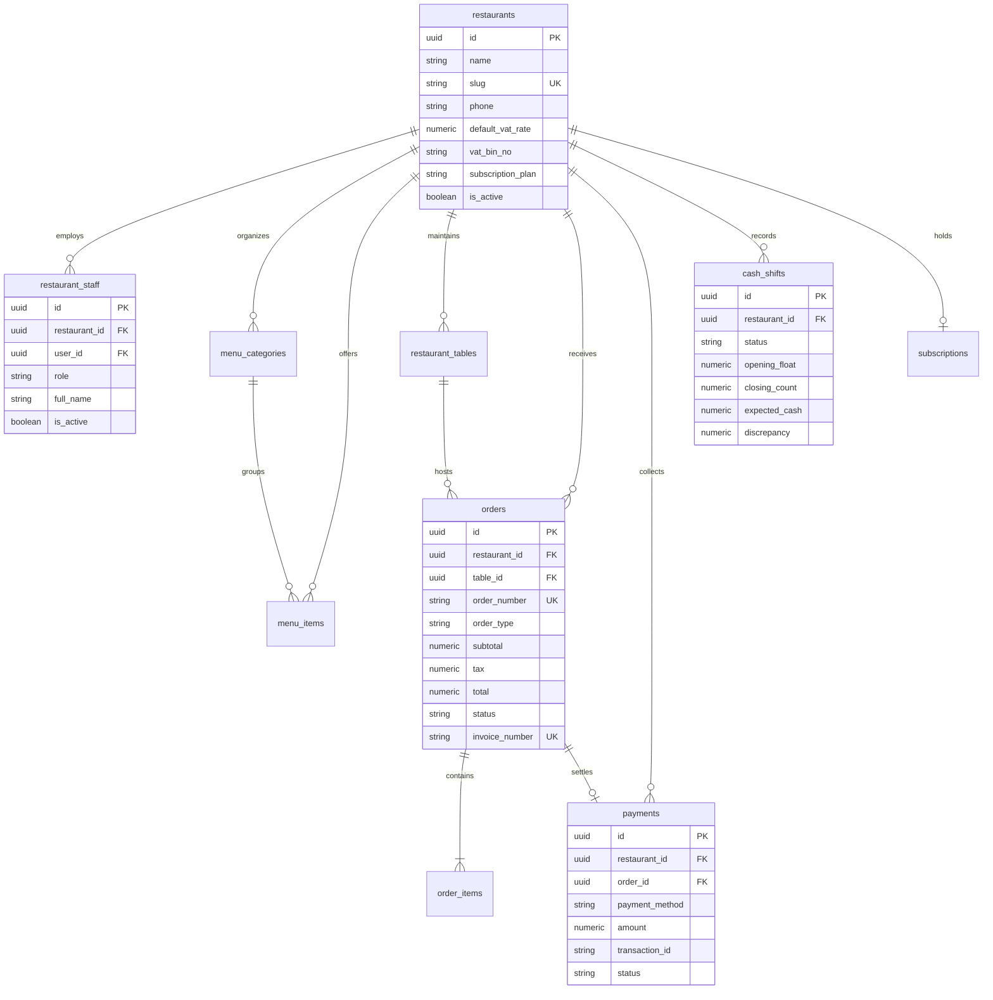
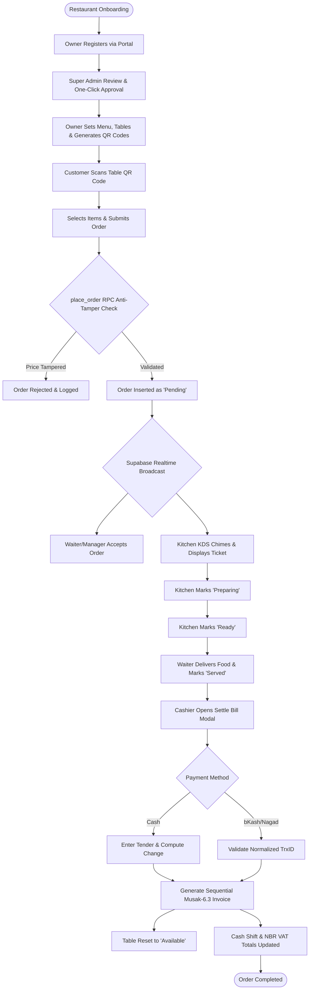

# AmarMenu — Cloud Restaurant Operating System
## Complete Slide-by-Slide Presentation Content Deck

---

## Slide 1 — Title Slide

### **AmarMenu: Cloud Restaurant Operating System**
#### *Next-Generation Multi-Tenant SaaS Platform for Bangladesh's F&B Industry*

* **Live Deployment:** [amarmenu-saas-rm17.vercel.app](https://amarmenu-saas-rm17.vercel.app)
* **Architecture:** Multi-Tenant Cloud Architecture (React 19 + Supabase PostgreSQL)
* **Presenter Name:** [Insert Presenter Name]
* **Student / Candidate ID:** [Insert Student ID]
* **Academic Supervisor:** [Insert Supervisor Name & Designation]
* **Institution:** Department of Computer Science & Engineering, [Insert University]

> **Speaker Notes (2–3 sentences):**  
> *"Good morning, respected supervisor and members of the board. Today, I am proud to present AmarMenu, a purpose-built Cloud Restaurant Operating System engineered to digitize, streamline, and secure food and beverage operations across Bangladesh. AmarMenu combines contactless QR ordering, real-time kitchen display, automated cash shift reconciliation, and NBR VAT compliance into a unified multi-tenant SaaS platform."*

---

## Slide 2 — Table of Contents

### **Presentation Roadmap**

1. **Problem Statement & Market Opportunity** — The F&B digitization gap in Bangladesh
2. **Existing vs. Proposed System** — Legacy paper/desktop POS vs. AmarMenu Cloud OS
3. **Software Development Life Cycle (SDLC)** — Agile-driven phased engineering
4. **Tools & Technology Stack** — React 19, TypeScript, Vite, Supabase PostgreSQL & RLS
5. **Project Schedule & Gantt Chart** — 8-week structured execution timeline
6. **Functional Architecture & Ordering Modalities** — 4 core dining pathways
7. **Order Lifecycle & Role-Based Access Control (RBAC)** — 5-stage state machine & 5 staff roles
8. **User Interface Walkthrough** — Responsive customer menu, KDS & management console
9. **Backend, Security & Performance Highlights** — Row-Level Security, zero-wait hydration & sub-250ms latency
10. **System Diagrams** — Architectural ER diagram and end-to-end operational flowchart
11. **Risk Mitigation & SWOT Analysis** — Connectivity resiliency & competitive positioning
12. **Financial Viability & SaaS Unit Economics** — BDT subscription tiers & revenue projections
13. **Future Roadmap & Conclusion** — B2B inventory marketplace & fintech expansion

> **Speaker Notes (2–3 sentences):**  
> *"This presentation covers the complete engineering and commercial journey of AmarMenu across 17 structured slides. We will examine the core market problem, our modern tech stack, the database architecture, operational workflows, and our verified financial model for sustainable SaaS scaling."*

---

## Slide 3 — Introduction & Problem Statement

### **The Bangladesh F&B Digitization Crisis**

* **Paper & Legacy POS Dominance:** Over 85% of 60,000+ restaurants in Bangladesh rely on pen-and-paper KOTs or vulnerable, single-PC offline desktop software.
* **Aggregator Commission Trap:** Third-party food aggregators extract 20% to 30% commission per order, eroding restaurant net margins.
* **Cash Drawer & Bill Leakage:** Unaudited handwritten bills and unmonitored voids result in 5% to 10% daily revenue leakage across cash drawers.
* **NBR Fiscal Non-Compliance:** Manual invoicing struggles with mandatory National Board of Revenue (NBR) VAT tracking, Musak-6.3 receipts, and BIN reporting.
* **The AmarMenu Solution:** A commission-free, cloud-native restaurant OS offering QR ordering, real-time kitchen routing, immutable audit logs, and automated NBR sales reporting for a flat monthly subscription.

> **Speaker Notes (2–3 sentences):**  
> *"The Bangladeshi dining sector is expanding rapidly, yet the vast majority of restaurants are paralyzed by outdated desktop software and aggressive 25% aggregator cuts. AmarMenu liberates restaurant owners by offering a modern, direct-to-consumer ordering platform with built-in financial governance, eliminating cash theft and ensuring strict fiscal compliance."*

---

## Slide 4 — Existing vs. Proposed System

### **Comparative System Analysis**

| Operational Dimension | Legacy Desktop POS / Paper Systems | AmarMenu Cloud Restaurant OS |
| :--- | :--- | :--- |
| **Ordering Channel** | Paper order slips written by hand; verbal shouting | Dynamic QR code scanning, Waiter handheld POS, & Counter Takeaway |
| **Kitchen Sync (KOT)** | Physical paper slip walking; frequent misplaced tickets | Sub-second Kitchen Display System (KDS) with Web Audio chime alerts |
| **Financial Security** | Arbitrary bill cancellation with zero audit trail | Cryptographic Manager PIN required for voids; immutable PostgreSQL audit logs |
| **NBR VAT & Reporting** | Tedious manual end-of-month tallying; audit vulnerability | Automated 5% NBR VAT calculation, sequential Musak-6.3 invoice sequences |
| **Cash Drawer Governance**| Blind end-of-day counting; undocumented drawer shortages | Enforced Cash Drawer Shifts with expected cash vs. closing count reconciliation |
| **Infrastructure & Cost** | Costly dedicated server hardware; zero remote access | Cloud PWA accessible on any phone, tablet, or browser for flat monthly BDT pricing |

> **Speaker Notes (2–3 sentences):**  
> *"When comparing legacy systems to AmarMenu, the difference is night and day. Where traditional solutions suffer from paper loss, unmonitored employee voids, and zero remote visibility, AmarMenu introduces instant digital synchronization, tamper-proof audit trails, and accessible mobile interfaces across the dining floor."*

---

## Slide 5 — SDLC / Process Model

### **Tailored Agile & Iterative Engineering**

* **Phase 1: Domain Discovery & Legal Compliance (Week 1)**  
  Field research with local restaurant managers; NBR Musak-6.3 statutory rules and Bangladesh F&B tax analysis.
* **Phase 2: Multi-Tenant Schema & Security Hardening (Weeks 2–3)**  
  PostgreSQL database design, Row-Level Security (RLS) policies, atomic `place_order` stored procedures, and audit triggers.
* **Phase 3: Core PWA & Realtime Engine Development (Weeks 4–5)**  
  Customer bilingual QR Menu, WebSocket-driven live order routing, Kitchen Display System (KDS), and Waiter POS modules.
* **Phase 4: Cash Drawer Governance & Hardening (Week 6)**  
  Shift opening/closing floats, discrepancy calculations, Z-Report generator, and Manager PIN rate-limiting.
* **Phase 5: Automated Testing, Security Audit & Cloud Launch (Weeks 7–8)**  
  300+ Vitest integration tests, role privilege regression, code-splitting optimization, and Vercel production deployment.

> **Speaker Notes (2–3 sentences):**  
> *"We executed an iterative Agile methodology structured across five specialized sprints. This iterative approach allowed us to continually validate our fiscal logic against Bangladesh's NBR regulations while systematically testing security rules at every database layer before deploying to production."*

---

## Slide 6 — Tools & Technology Stack

### **Full-Stack Enterprise Cloud Architecture**

* **Frontend Framework & Tooling:**  
  * **React 19** with **TypeScript** for strict type-safe modular UI component architecture.  
  * **Vite 7** build engine with Rollup code-splitting (`vendor-react`, `vendor-supabase`, `vendor-charts`, `vendor-icons`).  
  * **Tailwind CSS 3.4** for rapid, mobile-first responsive interfaces optimized for handhelds.
* **Backend, Database & Storage:**  
  * **Supabase PostgreSQL 15** providing relational ACID data modeling and atomic transactions.  
  * **PostgreSQL Row-Level Security (RLS)** ensuring airtight multi-tenant tenant isolation.  
  * **PostgreSQL Stored Procedures & Triggers** (`place_order`, `settle_order_bill`, `void_order_item`).
* **Realtime Synchronization & Web APIs:**  
  * **Supabase Realtime WebSockets** (`postgres_changes`) for sub-second live order state synchronization.  
  * **Web Audio API** synthesized audio alerts for kitchen queue ticket notifications.
* **Reporting, Hardware & Deployment:**  
  * **jsPDF & html2canvas** client-side generation for 80mm/58mm thermal receipts and Z-Reports.  
  * **Vitest 5.1** running 300+ end-to-end and privilege test cases.  
  * **Vercel Edge Network** global CDN delivery with sub-250ms initial asset loading.

> **Speaker Notes (2–3 sentences):**  
> *"Our technology stack is 100% grounded in modern, production-grade tools. By pairing React 19 on Vite with Supabase PostgreSQL, we achieve instantaneous realtime updates without maintaining heavy custom server daemons, while Row-Level Security enforces tenant boundaries at the database engine level."*

---

## Slide 7 — 8-Week Gantt Chart

### **Project Execution & Sprint Timeline**

```
Weeks      | W1 | W2 | W3 | W4 | W5 | W6 | W7 | W8 |
---------------------------------------------------
1. Req & NBR Tax Study   |████|    |    |    |    |    |    |    |
2. DB Schema & RLS Setup |    |████|████|    |    |    |    |    |
3. Auth & 5-Role RBAC    |    |    |████|████|    |    |    |    |
4. Bilingual QR Menu PWA |    |    |    |████|████|    |    |    |
5. Live Orders & KDS     |    |    |    |    |████|████|    |    |
6. Cash Shifts & Z-Report|    |    |    |    |    |████|████|    |
7. Automated E2E Testing |    |    |    |    |    |    |████|████|
8. Vercel CI/CD Launch   |    |    |    |    |    |    |    |████|
```

* **Milestone 1 (Week 2):** Database schema baseline and multi-tenant RLS policies verified.
* **Milestone 2 (Week 4):** Customer contactless QR menu functioning with bilingual English/Bengali support.
* **Milestone 3 (Week 6):** Realtime Kitchen Display System and Cash Shift management operational.
* **Milestone 4 (Week 8):** Complete test suite passing (300/300 tests) and production deployment live on Vercel.

> **Speaker Notes (2–3 sentences):**  
> *"Our 8-week implementation timeline adhered strictly to our milestones. We prioritized backend data integrity and security early in Weeks 2 and 3, allowing subsequent frontend interfaces—such as the customer menu and KDS—to build upon a solid, fully tested foundation."*

---

## Slide 8 — Functional Approach: 4 Ordering Modalities

### **Versatile Multi-Channel Ordering Engine**

* **1. Contactless Dine-In Table QR:**  
  * Guests scan a cryptographically signed table QR code.  
  * Table number is auto-locked; prevents unauthorized off-premise ordering.  
  * Instant access with zero native app installation required.
* **2. Waiter Handheld Digital POS:**  
  * Floor staff take table-side orders on any standard Android/iOS smartphone.  
  * Add custom item notes, size variants (e.g., Small/Regular), and add-ons in real time.
* **3. Fast Takeaway / Walk-in Counter:**  
  * Cashiers rapidly punch counter takeaway orders.  
  * Instant token number generation for customer pickup queues.
* **4. Direct Commission-Free Online Storefront:**  
  * Web storefront accessible via restaurant slug (`/menu/:slug`).  
  * Direct pickup and takeaway orders bypassing the 25% aggregator commission fee.

> **Speaker Notes (2–3 sentences):**  
> *"AmarMenu supports every style of food ordering found in modern eateries. Whether a guest is seated at a table scanning a QR code, a waiter is entering items on a handheld phone, or a customer is ordering takeout at the counter, all transactions flow into one centralized engine."*

---

## Slide 9 — End-to-End Order Lifecycle & RBAC

### **5-Stage State Machine & Strict Role Boundaries**

```
[Customer / Waiter] ---(place_order)---> PENDING
                                            |
[Manager / Waiter / Cashier] -----------> ACCEPTED (KOT Printed)
                                            |
[Kitchen Staff] ------------------------> PREPARING
                                            |
[Kitchen Staff] ------------------------> READY (Chime Alert)
                                            |
[Waiter / Runner] ----------------------> SERVED
                                            |
[Cashier / Manager] -(settle_order_bill)-> COMPLETED (Invoice Generated)
```

* **Owner:** Full visibility, tenant settings, staff invitations, subscription billing, and revenue analytics.
* **Manager:** Table assignment, order confirmation, discount authorization, and PIN-protected order voids.
* **Waiter:** Dine-in order punching, table status updates, and mark-as-served capabilities.
* **Kitchen:** View-only live KDS queue; toggle preparing/ready states; zero financial data exposed (ADR-025 compliance).
* **Cashier:** Cash/bKash/Nagad bill settlement, shift opening/closing, and Musak-6.3 invoice printing.

> **Speaker Notes (2–3 sentences):**  
> *"Our order workflow is protected by a strict 5-stage state machine enforced directly in PostgreSQL triggers. We implement rigorous Role-Based Access Control where kitchen staff only see item tickets without financial figures, while cashiers and managers handle settlement and discount authorizations."*

---

## Slide 10 — User Interface Walkthrough

### **Production UI Highlights & Visual Tour**

* **1. Customer Bilingual QR Menu:**  
  * Instant toggle between English and Bengali (বাংলা).  
  * High-performance floating cart drawer with interactive quantity steppers.  
  * Addon selection and dynamic price calculations.
* **2. Live Orders Kanban Hub:**  
  * Color-coded order cards showing elapsed time badges.  
  * Single-click actions for Accept, Print KOT, Mark Ready, and Settle.
* **3. Kitchen Display System (KDS):**  
  * High-contrast dark-mode interface designed for hot, low-light kitchen environments.  
  * Audio alerts via Web Audio API on new incoming tickets; full-screen mode toggle.
* **4. Owner & Cashier Executive Dashboard:**  
  * Real-time gross sales, net sales, 5% NBR VAT tally, and average order value.  
  * Cash drawer shift balances with expected vs. actual reconciliation badges.

> **Screenshot Checklist for Live Presentation:**  
> 1. *Customer Menu with Bilingual Toggle and active Cart drawer.*  
> 2. *Live Orders Kanban board displaying active multi-table status.*  
> 3. *Kitchen KDS dark-mode screen with 'Preparing' and 'Ready' tickets.*  
> 4. *Cashier Shift Z-Report modal with cash breakdown and discrepancy tracker.*

> **Speaker Notes (2–3 sentences):**  
> *"The user interface has been tailored to the high-pressure reality of busy commercial restaurants. From high-contrast dark themes on the kitchen KDS to rapid, thumb-friendly steppers on customer mobile phones, every screen is engineered for speed, legibility, and zero friction."*

---

## Slide 11 — Backend, Security & Performance Highlights

### **Enterprise-Grade Multi-Tenant Isolation**

* **PostgreSQL Row-Level Security (RLS):**  
  * Built-in security context (`current_restaurant_id()`) attached to all queries.  
  * 100% tenant isolation prevents cross-tenant data leaks between neighboring restaurants.
* **Anti-Tampering Price Verification:**  
  * The atomic `place_order` procedure re-evaluates database prices independently.  
  * Rejects client-side price tampering or discount spoofing with instant rollback.
* **Cryptographic Manager Void Audit:**  
  * Cancelled orders or waived items require a 4-digit Manager PIN and mandatory reason text.  
  * Stored in append-only `audit_logs` table protected by `prevent_audit_log_mutation()` trigger.
* **High-Speed Frontend Optimization:**  
  * Main vendor bundle compressed to `222 kB`; lightweight customer QR menu loads in just `25 kB`.  
  * SWR stale-while-revalidate client caching ensures instantaneous tab switching.

> **Speaker Notes (2–3 sentences):**  
> *"Security in AmarMenu is not an afterthought in frontend code; it is baked directly into PostgreSQL. With Row-Level Security policies, server-side price recalculation, and append-only audit triggers, we guarantee that no customer can manipulate prices and no staff member can erase financial history."*

---

## Slide 12 — Database ER Diagram

### **Relational Schema Architecture**



> **Speaker Notes (2–3 sentences):**  
> *"Here is the relational database entity model powering AmarMenu. Every transaction, order item, and payment strictly references the parent restaurant tenant ID, while normalized tables for staff, cash shifts, and tables ensure complete referential integrity across the entire restaurant lifecycle."*

---

## Slide 13 — System Flowchart

### **End-to-End Operational Flow**



> **Speaker Notes (2–3 sentences):**  
> *"This flowchart illustrates the complete lifecycle of a dining transaction in AmarMenu. From initial onboarding approval to table QR ordering, real-time kitchen broadcast, and final cashier cash tender calculation, every action triggers automated updates across the entire system."*

---

## Slide 14 — Risk Analysis & Mitigation

### **Operational Resilience & Risk Management**

* **Risk 1: Broadband / Internet Connectivity Drop**  
  * *Impact:* Interruption to live order synchronization and billing.  
  * *Mitigation:* Global `navigator.onLine` listener displaying sticky amber warning banners; automatic background reconnect toast; preserved customer cart state with idempotent retry key.
* **Risk 2: Accidental or Prank Dine-In QR Orders**  
  * *Impact:* Kitchen prepares unrequested food, causing wasted ingredients.  
  * *Mitigation:* Enforced 'Pending' verification stage where Waiter or Manager must accept tickets before KOT routing; client rate-limiting of 5 orders per phone per 5 minutes.
* **Risk 3: Staff Resistance & Non-Technical Usability Barriers**  
  * *Impact:* High onboarding friction among junior kitchen and waitstaff.  
  * *Mitigation:* Dual-language interface (English + native Bengali বাংলা); high-contrast visual status pills; one-touch status buttons requiring zero typing.
* **Risk 4: Cash Drawer Theft & Discrepancies**  
  * *Impact:* Unaccounted loss of daily cash takings.  
  * *Mitigation:* Strict shift-based float accounting (`expected_cash` vs `closing_count`); non-bypassable discrepancy recording on printed Z-Reports.

> **Speaker Notes (2–3 sentences):**  
> *"In developing AmarMenu, we anticipated key ground-level challenges in Bangladesh's restaurant environment. We incorporated network disconnection guards, dual-language interfaces for non-technical kitchen staff, and mathematical drawer reconciliation to ensure maximum system resilience."*

---

## Slide 15 — SWOT Analysis

### **Strategic Market Assessment**

```
STRENGTHS                                    WEAKNESSES
-------------------------------------------  -------------------------------------------
• Zero aggregator commission model           • Requires steady smartphone/tablet access
• Full compliance with NBR Musak-6.3 VAT     • Initial staff onboarding and habit change
• Modern, app-less customer QR experience    • Cloud-dependency requires internet uptime
• Sub-second Supabase WebSocket sync

OPPORTUNITIES                                THREATS
-------------------------------------------  -------------------------------------------
• 60,000+ under-digitized eateries in BD     • Entrenched legacy offline desktop vendors
• Increasing nationwide adoption of bKash    • Unstable broadband connectivity in rural areas
• Government push for digital VAT reporting  • Restaurant margin sensitivity to subscriptions
• Potential B2B ingredient supply expansion
```

* **Competitive Edge:** Unlike legacy desktop software requiring expensive onsite servers, AmarMenu runs directly on existing staff phones with zero upfront hardware investment.

> **Speaker Notes (2–3 sentences):**  
> *"Our SWOT analysis highlights AmarMenu's strategic advantage in the Bangladeshi market. By combining zero-commission direct ordering with mandatory NBR VAT compliance, we occupy a sweet spot that neither traditional desktop software nor aggregator apps address."*

---

## Slide 16 — Cost Analysis & SaaS Pricing Model

### **Predictable Subscription Tiers (BDT)**

```
=============================================================================
STARTER PLAN             GROWTH PLAN (Popular)    ENTERPRISE PLAN
৳1,499 / month           ৳2,999 / month           ৳5,999 / month
-----------------------------------------------------------------------------
• Up to 15 Tables        • Unlimited Tables       • Multi-Branch Support
• Up to 3 Staff Accounts • Up to 10 Staff         • Unlimited Staff
• Bilingual QR Menu      • Kitchen Display (KDS)  • Custom Domain & Branding
• Cash Shift Management  • NBR Musak-6.3 Reports  • Central Inventory
• Single Printer Sync    • bKash / Nagad TrxID    • Dedicated Account Mgr
=============================================================================
```

* **Setup & Onboarding:** One-time initial setup and staff training fee: `৳5,000` (includes personalized acrylic QR standee prints).
* **Target Unit Economics (Pilot Target — 100 Outlets):**  
  * 70 Outlets on Growth Plan (`70 × ৳2,999` = `৳2,09,930`)  
  * 30 Outlets on Starter Plan (`30 × ৳1,499` = `৳44,970`)  
  * **Monthly Recurring Revenue (MRR):** `~৳3 Lakh MRR`  
  * **Annual Recurring Revenue (ARR):** `~৳36 Lakh ARR`  
* **Low Infrastructure Overhead:** Managed Supabase and Vercel hosting costs average `< ৳250` per outlet/month, delivering `~90%` gross SaaS margins.

> **Speaker Notes (2–3 sentences):**  
> *"Our subscription tiers are specifically priced for the Bangladesh market, ranging from ৳1,499 to ৳5,999 per month. With 100 restaurants onboarded, AmarMenu generates ৳3 Lakh in Monthly Recurring Revenue, with low cloud infrastructure overhead yielding a 90% gross margin."*

---

## Slide 17 — Future Recommendations & Conclusion

### **Strategic Evolution & Closing Summary**

* **Future Roadmap (Next 12–18 Months):**  
  * **B2B Bulk Ingredient Marketplace:** Enable restaurants to order bulk poultry, rice, and cooking oil directly from verified wholesalers within the dashboard.  
  * **Fintech Merchant Credit Scoring:** Leverage immutable daily sales analytics to qualify restaurants for collateral-free SME working capital loans from microfinance institutions.  
  * **Cross-Merchant Customer Loyalty:** Coalition points network allowing diners to accumulate and redeem dining reward points across partner outlets.
* **Key Academic & Technical Takeaways:**  
  * Proved the viability of serverless multi-tenant architectures utilizing PostgreSQL RLS.  
  * Successfully solved the dual challenge of anti-tampering security and high-speed dining UX.
* **Live System Verification:**  
  * Web Application live at: [amarmenu-saas-rm17.vercel.app](https://amarmenu-saas-rm17.vercel.app)
* **Thank You! Open for Questions & Evaluation.**

> **Speaker Notes (2–3 sentences):**  
> *"In conclusion, AmarMenu is not simply a digital menu; it is an integrated cloud operating system that addresses real economic, operational, and fiscal pain points for restaurants in Bangladesh. Thank you for your time and guidance; I would now be delighted to answer your questions."*
